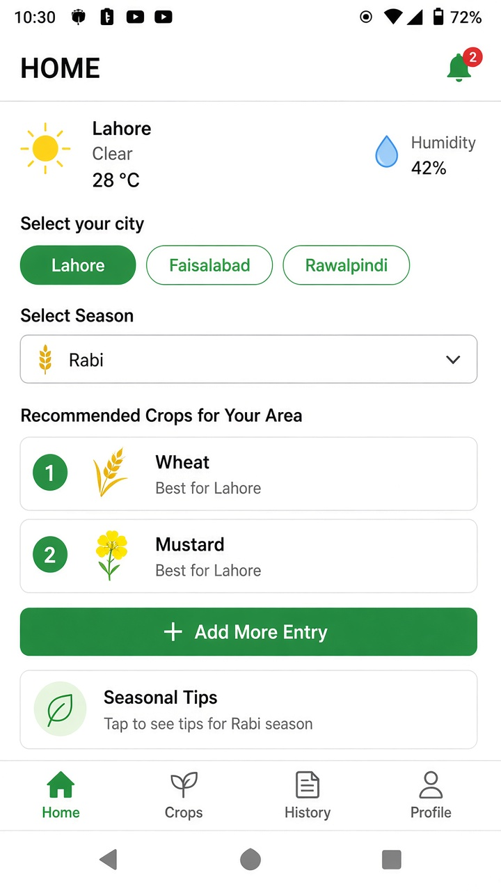
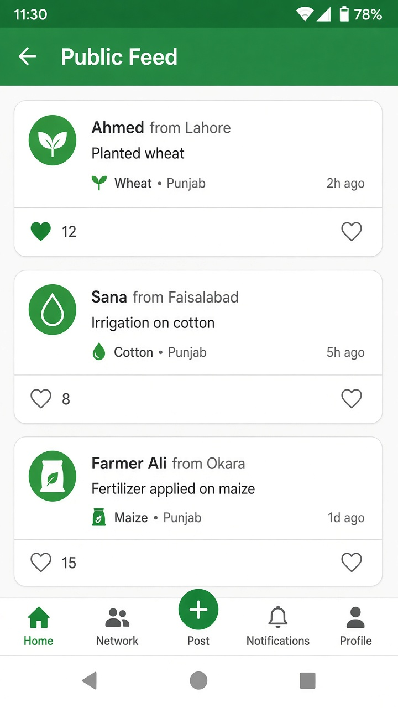
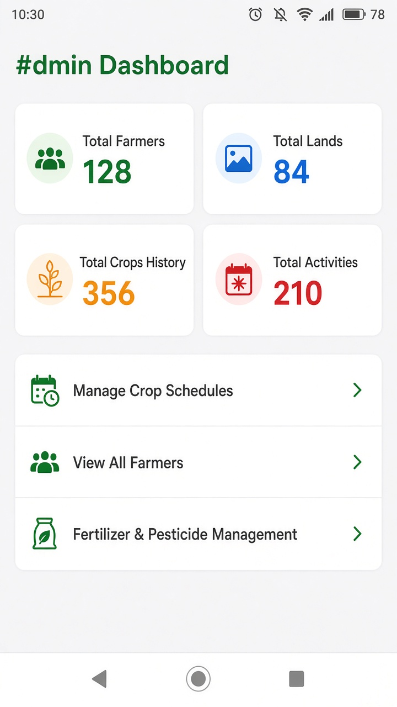

# Intelligent Kisan Diary

**Final Year Project** — AI crop recommendation for Pakistani farmers, with a React Native app and a Python FastAPI backend.

Farmers log land, crops, fertilizer, and pesticide. The Python model ranks crops for their city, season, and soil. Neighbours’ public activities and an admin dashboard sit on the same API.

The app is **React Native** (`frontend/`) plus **Python** FastAPI + scikit-learn (`backend/`). GitHub’s language bar counts Python; the mobile UI is still in this repo.

## Screenshots

<p align="center">
  
  
</p>
<p align="center"><em>Farmer login · Home — weather, city, season, ranked crop cards</em></p>

<p align="center">
  
  
</p>
<p align="center"><em>Public activity feed · Admin dashboard — farmers, lands, crops, schedules</em></p>

## Problem

Smallholders in Punjab pick a crop from habit or a neighbour, then lose money when soil, season, or market does not match.

They need one phone app that:

- Recommends **which crop** for this city / season / soil
- Stores **land, sowing, fertilizer, pesticide, yield**
- Shows **what nearby farmers** actually planted
- Lets an **admin** manage schedules, rates, and users
- Works in **Urdu and English**

## Features

| Area | What it does |
| --- | --- |
| **Auth** | Unified farmer / admin login, signup with land (city, area, zone, soil, size) |
| **Home** | Live weather, city chips, Rabi / Kharif, top-2 crop cards from the ML model |
| **Diary** | Add crop, fertilizer, pesticide, land; mark activities complete; log yield |
| **Local intel** | Nearby lands, popular crop / fertilizer / pest, profit vs loss |
| **Public feed** | Shared activities + likes (privacy toggle per activity) |
| **Admin** | Farmers, crop schedules, fertilizer & pesticide catalogues, analytics |
| **i18n** | Urdu / English toggle across screens |

## Python (ML + API)

`backend/model_utils.py` + `backend/models/`:

1. **Crop production model** — scikit-learn regressor pickled as `crop_model.pkl`, with label encoders for city, crop, season, soil.
2. **Recommend** — for a city + season + soil, score season-legal crops and return the **top 2** by predicted production (`POST /api/recommend`).
3. **Class imbalance** — SMOTE or NearMiss (`imbalanced-learn`) on historical crop rows before local analytics, when class counts are skewed.

`backend/main.py` is the FastAPI app: MySQL (farmer, land, crop history, activities, market rates), Open-Meteo weather for Pakistani cities, admin statistics.

Not a deep neural net — a classical sklearn pipeline on agricultural history. That is the FYP ML component.

```bash
cd backend
pip install -r requirements.txt
uvicorn main:app --reload
```

API docs: [http://127.0.0.1:8000/docs](http://127.0.0.1:8000/docs)

## React Native (JavaScript)

`frontend/` is the mobile app. It was not removed.

React Native 0.81, React Navigation (stack + tabs), Axios, maps / geolocation, chart-kit, AsyncStorage, Urdu+English `localization/`.

```bash
cd frontend
npm install
npm start
npm run android
```

Point `frontend/api.js` at your FastAPI URL.

## Tech stack

| Layer | Stack |
| --- | --- |
| **Python** | FastAPI, scikit-learn, imbalanced-learn (SMOTE / NearMiss), pandas, NumPy, MySQL Connector, Uvicorn |
| **JavaScript** | React Native, React Navigation, Axios |
| **Data** | MySQL (`INTELLIGENT_KISAN_DIARY`) |
| **Weather** | Open-Meteo (no API key) |

## Architecture

```text
React Native app (farmer + admin)
        │  HTTP JSON
        ▼
FastAPI  (backend/main.py)
        ├── /api/recommend     sklearn crop model
        ├── /weather/{city}    Open-Meteo
        ├── /unified-login     farmer | admin
        ├── diary / feed / land / rates
        └── /admin/*           schedules, farmers, analytics
        │
        ▼
MySQL + backend/models/*.pkl
```

Cities in the model: Rawalpindi, Faisalabad, Lahore, Multan, Gujrat, Sialkot.  
Seasons: **Rabi** (wheat, mustard, barley, chana) and **Kharif** (rice, cotton, maize, …).

## Repository layout

```text
intelligent_kisan_diary/
├── frontend/          React Native (JavaScript)
│   ├── *Screen.js     farmer + admin screens
│   ├── localization/  Urdu / English
│   └── android/ ios/  native shells
└── backend/           Python
    ├── main.py        FastAPI
    ├── model_utils.py crop model + SMOTE/NearMiss
    ├── models/        crop_model.pkl + encoders
    └── requirements.txt
```

## Run locally

### Backend

```bash
cd backend
python -m venv .venv
.venv\Scripts\activate
pip install -r requirements.txt
copy .env.example .env
# set DB_PASSWORD in .env
uvicorn main:app --reload
```

Needs MySQL with database `INTELLIGENT_KISAN_DIARY`.

### Frontend

```bash
cd frontend
npm install
npm start
npm run android
```

Do not commit `.env`. Copy `backend/.env.example`.

## Role

Solo FYP: React Native farmer/admin app, FastAPI + MySQL, sklearn crop recommendation, SMOTE/NearMiss on local history, Urdu/English UI.

## License

Published for academic review (Final Year Project).
